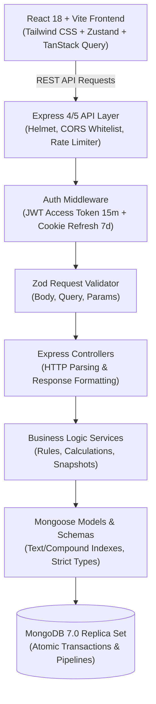
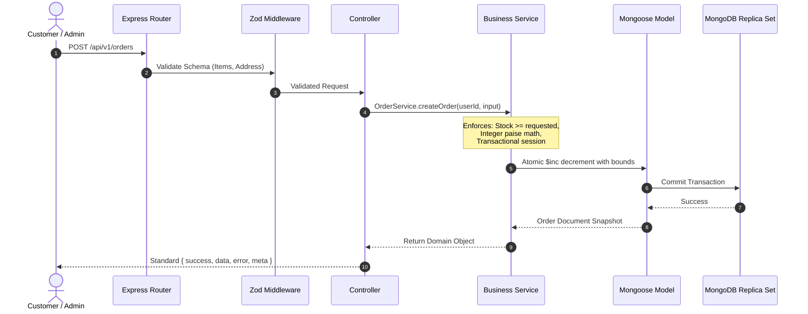
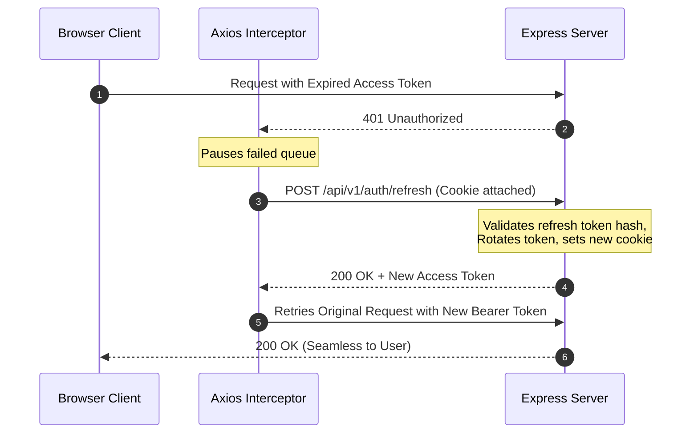
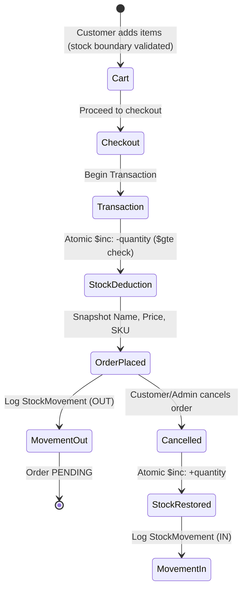

# StockDrive IMS — System Architecture Documentation

StockDrive IMS is a production-grade Inventory Management System and Storefront for automotive accessories, built using the modern MERN stack with strict TypeScript, layered architecture, and transactional integrity.

## 1. High-Level Architecture Diagram

## 2. Layering Architecture

The backend strictly separates responsibilities into four distinct layers:

## 3. Authentication & Silent Token Refresh Flow

- **Access Token:** Short-lived JWT (15 minutes), signed with `JWT_ACCESS_SECRET`, carrying user id, email, and role.
- **Refresh Token:** Long-lived JWT (7 days), stored in an `httpOnly`, `secure`, `sameSite` cookie.
- **Token Rotation:** Each refresh request invalidates the previous hashed token and issues a fresh pair. Replay attacks trigger immediate session revocation.

## 4. Transactional Checkout & Restock Lifecycle

